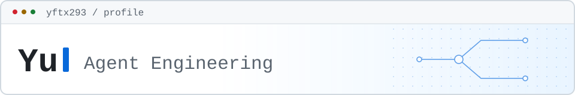

<picture>
  <source media="(prefers-color-scheme: dark)" srcset="./assets/terminal-dark.svg">
  
</picture>

持续学习 AI，构建可靠的 Agent 系统，打磨好用的产品。代码之外，喜欢音乐与文学。

## [OpenDot](https://github.com/yftx293/OpenDot)

一个可自托管的个人 AI 助手与团队工作台。把任务交给 Agent，随时查看进度和处理授权，换一台设备也能接着做。

[查看界面](https://github.com/yftx293/OpenDot#界面与体验) · [下载桌面预览版](https://github.com/yftx293/OpenDot/releases/latest)

## 开源贡献

<!-- CONTRIB:BEGIN -->
**31 个公开 PR 已合并**，分布在 6 个仓库，其中 25 个在 OpenHands SDK。 [查看全部 PR](https://github.com/search?q=author%3Ayftx293+is%3Apr+is%3Amerged+is%3Apublic+-user%3Ayftx293&type=pullrequests) · 2026-11-19

- [OpenHands SDK #6386](https://github.com/OpenHands/software-agent-sdk/pull/6386) 修复可空数组和对象的 JSON Schema 转换，保留嵌套参数结构。
- [OpenHands SDK #6581](https://github.com/OpenHands/software-agent-sdk/pull/6581) 修复 LLM 实例重新注册时丢失累计 Token 和成本统计的问题。
<!-- CONTRIB:END -->

## 更多作品

- **[TinyCode](https://github.com/yftx293/tinycode)** — 用 Pi Agent Core 重实现终端 Coding Agent，探索工具权限、上下文管理和会话恢复。
- **[Folio](https://github.com/yftx293/folio)** — 本地优先的 AI 投研工作台，把结构化数据、研究证据和 Agent 协作放进同一个桌面应用。
- **[ShipCost AI](https://github.com/yftx293/shipcost-ai)** — 根据模型用量和调用频率，估算 Chatbot、RAG 和 Agent 应用的月度成本。

**[技术博客](https://blog-sandy-psi-42.vercel.app/)** · [Agent 跑到一半断了，下一次从哪接上？](https://blog-sandy-psi-42.vercel.app/blog/20261114-durable-agent-recovery/post)
