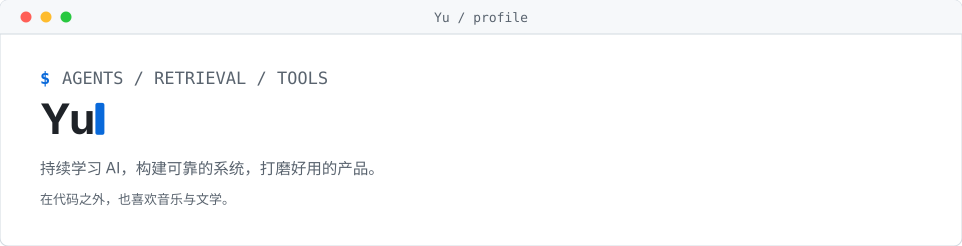
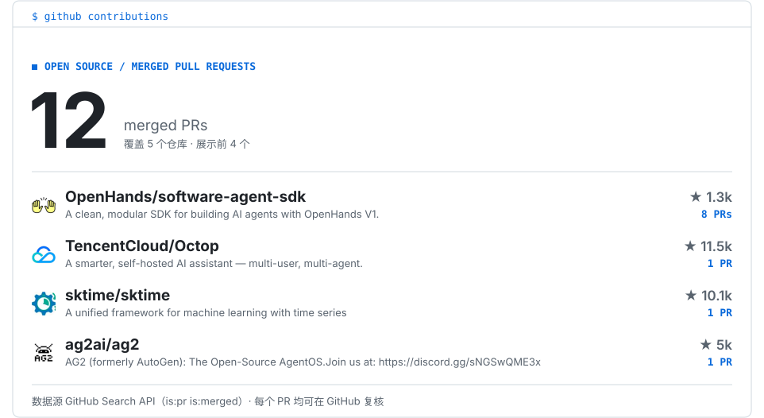

<picture>
  <source media="(prefers-color-scheme: dark)" srcset="./assets/hero-dark.svg">
  
</picture>

<!-- CONTRIB:BEGIN -->
<picture>
  <source media="(prefers-color-scheme: dark)" srcset="./assets/contrib-dark.svg">
  
</picture>
<!-- CONTRIB:END -->

[查看已合并的公开 PR](https://github.com/search?q=author%3Ayftx293+is%3Apr+is%3Amerged+is%3Apublic+-user%3Ayftx293&type=pullrequests) · [OpenHands SDK](https://github.com/OpenHands/software-agent-sdk/pulls?q=is%3Apr+is%3Amerged+author%3Ayftx293) · [Octop](https://github.com/TencentCloud/Octop/pulls?q=is%3Apr+is%3Amerged+author%3Ayftx293) · [sktime](https://github.com/sktime/sktime/pulls?q=is%3Apr+is%3Amerged+author%3Ayftx293) · [AG2](https://github.com/ag2ai/ag2/pulls?q=is%3Apr+is%3Amerged+author%3Ayftx293) · [octop-harness](https://github.com/TencentCloud/octop-harness/pulls?q=is%3Apr+is%3Amerged+author%3Ayftx293)

## 代表作品

- **[TinyCode](<https://github.com/yftx293/tinycode>)**：基于 Pi Agent Core 的终端 Coding Agent 学习型重实现，探索工具权限、会话恢复、Context 管理、Skills、MCP 与只读子 Agent。
- **[企业客服 Agentic RAG](<https://github.com/yftx293/enterprise-customer-service-agentic-rag>)**：从开源客服项目改造的中文场景应用：用 LangGraph 串联多来源检索、订单查询、工单流转和轻量评测。
- **[ShipCost AI](<https://github.com/yftx293/shipcost-ai>)**：面向 Chatbot、RAG 与 Agent 应用的 API 成本规划工具，把使用频率、模型调用次数和 Token 用量转换为月度成本与预算容量。
- **[Folio](<https://github.com/yftx293/folio>)**：持续开发与重构的本地优先 AI 投研工作台，围绕结构化数据、研究证据与 Agent 协作组织桌面体验。
